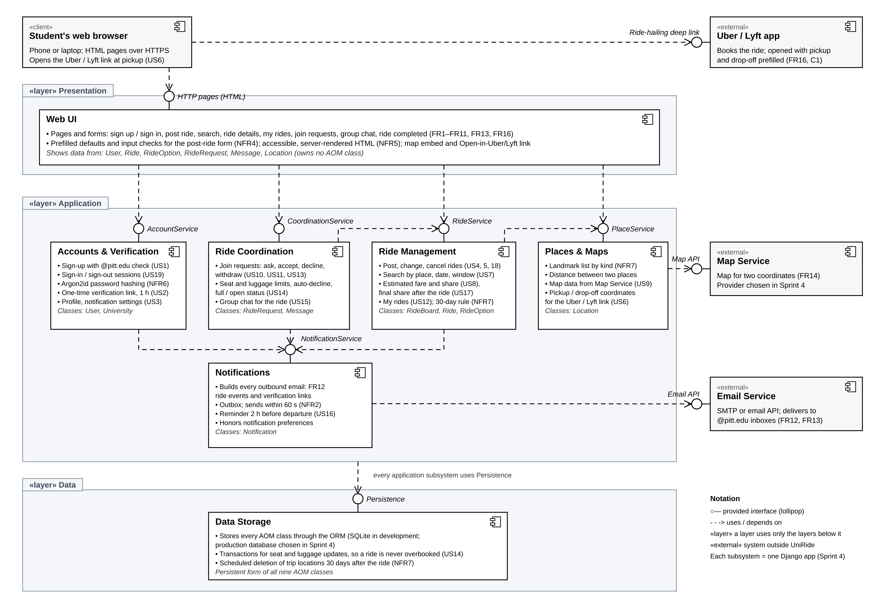
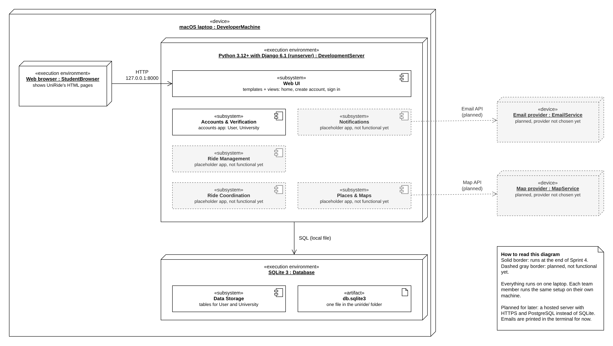

# UniRide

[](https://github.com/sidkhandelwal7/UniRide/actions/workflows/ci.yml)

- **Team name:** UniRide
- **Course:** CS 1530 Software Engineering, University of Pittsburgh, Fall 2026

## Project purpose

UniRide helps Pitt students find other students traveling to the same destination, such as Pittsburgh International Airport, the Greyhound station, or a concert venue. They can join the same Uber or Lyft and split the fare instead of paying for separate rides. Only students who verify an @pitt.edu email address can post, search for, or join rides.

The goal is for one student to post a trip and others to ask to join. The organizer books the ride separately and enters the fare afterward. Payments happen outside UniRide.

## Team

| Member              | Scrum role    | GitHub username |
| ------------------- | ------------- | --------------- |
| Siddhant Khandelwal | Product Owner | sidkhandelwal7  |
| Terrick Wright      | Scrum Master  | TLW94-git       |
| Jianghui Chen       | Developer     | EkkoZero        |
| Hayden Gilmer       | Developer     | hmg66           |

## Tech stack

| Layer | Technology | Why we chose it |
| ----- | ---------- | --------------- |
| Language(s) | Python 3.12 or newer, HTML, CSS | Django is a Python framework, so the server code and the tests are in one language. The pages are made on the server, so we do not need JavaScript yet. |
| Frontend | Django templates and one CSS file | This is our Web UI subsystem from Sprint 3. Most pages are forms and lists, so a separate front-end app would only add a second build process. One shared base template keeps the forms consistent (DG4). |
| Backend | Django 6.1.3 | It comes with accounts, sessions, forms, and an admin site. Each of our five application subsystems is one Django app. It also has an Argon2id password hasher, which we need for DG1 and NFR6. |
| Database | SQLite 3 through the Django ORM (PostgreSQL planned later) | This is our Data Storage subsystem. SQLite comes with Python, so nobody has to install a database server to run the skeleton. We plan to move to PostgreSQL when we host the app, because several students will be writing at the same time. |
| APIs / external services | Any SMTP email server (optional) | Emails are printed in the terminal unless SMTP settings are in `.env`. Testing delivery to Pitt inboxes is tracked in issue #38. The map service is not chosen yet because the map (US9) is outside the MVP. |
| Deployment / hosting | None yet. Django development server on each laptop | A running skeleton on our own machines is enough for this sprint. We will decide on hosting later. |

Other tools: `venv` and `pip` for packages, `python-dotenv` for the `.env` file, and Django's test runner for tests.

## Architecture

### Subsystem decomposition (Sprint 3)



### Deployment diagram (end of Sprint 4)

This diagram shows the Sprint 4 setup. The folder table below shows what has changed since then.



### Which folder contains which subsystem

All of the code is in the `uniride/` folder.

| Subsystem (Sprint 3) | Folder | Status |
| -------------------- | ------ | ------ |
| Web UI | `uniride/templates/` and `uniride/static/` for the shared layout, plus the `views.py`, `forms.py`, and `templates/` inside each app | Home, create account, sign in, and verification pages |
| Accounts & Verification | `uniride/accounts/` | Create account, email verification, sign in, and sign out work |
| Ride Management | `uniride/rides/` | Placeholder |
| Ride Coordination | `uniride/coordination/` | Placeholder |
| Notifications | `uniride/notifications/` | Sends the verification email |
| Places & Maps | `uniride/places/` | Placeholder |
| Data Storage | The `models.py` and `migrations/` in each app (Django ORM), and the database file `uniride/db.sqlite3` | User and University tables |

`uniride/config/` holds the Django settings and the main list of URLs. It is not a subsystem.

The file `db.sqlite3` is created on your own machine when you run the migrate step below. It is not in the repository.

## How to run UniRide

### What you need

- Git
- Python 3.12 or newer. Check with `python3 --version`. If it shows 3.11 or older, see [If something goes wrong](#if-something-goes-wrong) before you start.
- A web browser

Django 6.1.3 and python-dotenv 1.2.4 are installed in step 3.

### Steps

These commands are for the Terminal on macOS. The Windows versions are in the comments.

1. Get the code and go into the `uniride` folder.

   ```
   git clone https://github.com/sidkhandelwal7/UniRide.git
   cd UniRide/uniride
   ```

2. Make a virtual environment and turn it on.

   ```
   python3 -m venv .venv
   source .venv/bin/activate        # Windows: .venv\Scripts\activate
   ```

3. Install the packages.

   ```
   python -m pip install -r requirements.txt
   ```

4. Make your own `.env` file from the example.

   ```
   cp .env.example .env             # Windows: copy .env.example .env
   ```

5. Create the database.

   ```
   python manage.py migrate
   ```

   Run this again every time you pull new code, because new features can add new tables.

6. Start the server.

   ```
   python manage.py runserver
   ```

7. Open http://127.0.0.1:8000/ in your browser. Press Control-C in the terminal to stop the server.

### How to check that it works

1. The home page shows "Share an Uber or Lyft with other Pitt students".
2. Click **Create account**. Enter a name, an email that ends in `@pitt.edu`, and a password with at least 8 characters. Emails are printed in the terminal (see [Features](#features)), so a made-up `@pitt.edu` address works.
3. Try an email that does not end in `@pitt.edu`. You should see "Only @pitt.edu email addresses can sign up."
4. Sign in with the account you made. The home page should say "Hi," and your name, and ask you to verify your Pitt email.
5. Look in the terminal where the server is running. Copy the link from the "Verify your UniRide account" email and open it. You should see "Your Pitt email is verified" and a **Verified Pitt student** badge.
6. Click **Sign out**. You should see "You are signed out."
7. Stop the server and run the tests:

   ```
   python manage.py test
   ```

   The last line should say `OK`.

To look at the saved accounts, make an admin user with `python manage.py createsuperuser`, start the server again, and open http://127.0.0.1:8000/admin/.

### Sending real emails (optional)

By default UniRide prints emails in the terminal. To send real emails, for example to test delivery to Pitt inboxes (issue #38), copy the `EMAIL_` lines from `.env.example` into your `.env` and fill them in. With Gmail you need 2-Step Verification turned on and an app password, which you use as `EMAIL_HOST_PASSWORD`. Restart the server after changing `.env`. Never commit `.env`.

### If something goes wrong

**`No matching distribution found for Django[argon2]==6.1.3`**

The virtual environment was made with a Python older than 3.12. This often happens with Anaconda: if your terminal prompt starts with `(base)`, `python3` is Anaconda's Python, which can be older. Move the old virtual environment aside and make a new one with a newer Python. Run these in the `uniride` folder. If your prompt shows `(.venv)`, run `deactivate` first.

With Anaconda:

```
mv .venv .venv-old
conda create -n py313 python=3.13 -y
conda run -n py313 python -m venv .venv
source .venv/bin/activate
python --version
```

Without Anaconda: install Python 3.13 from [python.org](https://www.python.org/downloads/), then:

```
mv .venv .venv-old
python3.13 -m venv .venv
source .venv/bin/activate
python --version
```

`python --version` should show 3.12 or newer. Then continue from step 3.

**`ModuleNotFoundError: No module named 'django'`**

The packages are not installed in the virtual environment you are using. Check that your prompt shows `(.venv)`. If it does not, run `source .venv/bin/activate` in the `uniride` folder. Then run step 3 again.

**`Error: That port is already in use.`**

Run `python manage.py runserver 8001` and open http://127.0.0.1:8001/ instead.

## Features

### Create an account (US1)

A Pitt student makes an account with their name, @pitt.edu email, and a password. Other email addresses, and emails that already have an account, are rejected. The password is stored as an Argon2id hash (NFR6). New accounts start as unverified.

**How to use it:** click **Create account** on the home page and fill in the form.

### Verify your Pitt email (US2)

Right after sign-up, UniRide emails the student a one-time verification link. Opening the link verifies the account. A link stops working once it has been used, after 1 hour, or when a newer link is sent. Students who are not verified cannot post, find, or join rides. They see a message asking them to verify first, with a **Send me a new link** button.

**How to use it:** after creating an account, open the link in the email. While we develop, the email is printed in the terminal where `runserver` is running, so copy the link from there. To get a new link, sign in and click **Send me a new link**.

### Sign in and out (US19)

A student signs in with their Pitt email and password. A wrong email or password shows one message that does not say which one was wrong. Every page has a **Sign out** button. Pages that need a verified student tell the browser not to keep a copy, to help keep them from being displayed after sign-out.

**How to use it:** click **Sign in** at the top of any page.

### Admin site

The Django admin site shows the saved tables. Make an admin user with `python manage.py createsuperuser` and open http://127.0.0.1:8000/admin/.

## What does not work yet

- After signing in, the student sees the home page. US19 says it should be the My Rides page (US12), which is not built yet.
- The **Post a ride** and **Find a ride** buttons are turned off. The `rides`, `coordination`, and `places` apps are placeholders.
- Editing a profile (US3).
- Ride emails (requests, cancellations, reminders). Only the verification email is built.
- There is no map service or hosting yet. The app only runs on a laptop with SQLite.

## Backlog

Our user stories are in `user-stories.md` and on the [issues page](https://github.com/sidkhandelwal7/UniRide/issues). The setup tasks for Sprint 4 have the `setup` label.

## How we use Git

We follow GitHub Flow. `main` always has working code, and every change goes through a pull request.

| Branch type | Naming convention | Example |
| ----------- | ----------------- | ------- |
| Feature | `feature/<description>` | `feature/verify-email` |
| Bugfix | `bugfix/<description>` | `bugfix/login-redirect` |
| Main | `main` | `main` |

Our rules:

1. Nobody commits directly to `main`. Make a new branch from the newest `main` for each story or task.
2. Branch descriptions are short, lowercase, and use dashes, for example `feature/post-ride`.
3. Commit messages start with a type: `feat:`, `fix:`, `test:`, `docs:`, `ci:`, or `refactor:`. Example: `feat: add the post a ride page (US4)`.
4. Open a pull request into `main` and link its issue in the description. Use `Closes #12` if the PR finishes the issue and `Refs #12` if it only does part of it. Work that is not a user story, like setting up CI, gets a task issue first.
5. At least one teammate who did not write the PR reviews it and leaves a comment on a specific line: a question, a suggestion, or something they noticed.
6. The Product Owner checks the acceptance criteria on the issue and approves the PR from the requirements side.
7. CI has to pass before we merge. We merge with **Create a merge commit** and keep the branch, so the history stays visible.

## Continuous integration

Our CI is a GitHub Actions workflow in `.github/workflows/ci.yml`. It runs on every pull request into `main`, when the PR is opened and each time new commits are pushed to it. It also runs after each merge into `main`. It:

1. installs Python 3.13 and our packages from `requirements.txt`,
2. runs `python manage.py check` to look for problems in the Django project,
3. runs `python manage.py makemigrations --check --dry-run` to make sure no model change is missing a migration,
4. runs all of our tests with `python manage.py test`.

The results are on the [Actions page](https://github.com/sidkhandelwal7/UniRide/actions). To run the same checks on your laptop before you push, run these in the `uniride` folder:

```
python manage.py check
python manage.py makemigrations --check --dry-run
python manage.py test
```

Next, we would like to add a linter (such as Ruff) and a test coverage report.

## One risk we still need to test

We do not know yet whether UniRide's emails will reliably reach Pitt inboxes. Students must receive a one-time link at their @pitt.edu address to verify their account (FR13), since using Pitt Passport would require university approval (C3). Ride updates must also arrive within 60 seconds (FR12 and NFR2).

Issue #38 tracks real inbox delivery. For each test, record when the message was sent and arrived, and whether it went to Junk. Ride-update emails are still planned.
