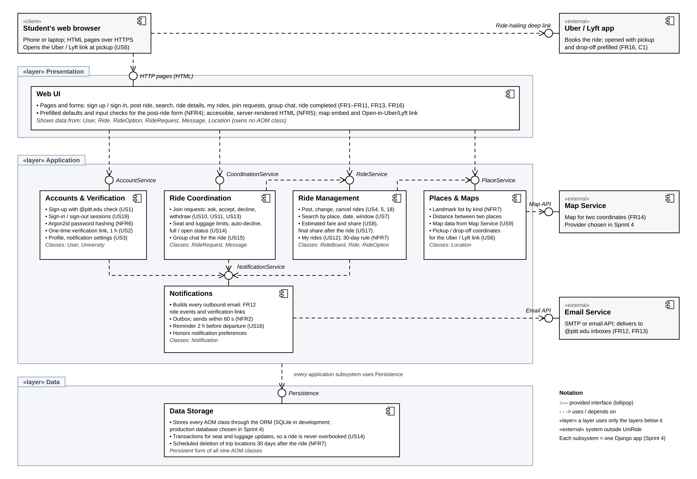
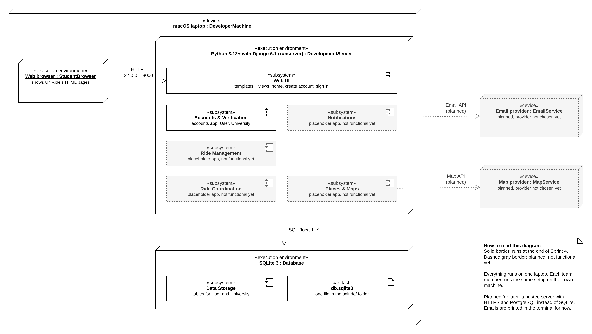

# UniRide

- **Team name:** UniRide
- **Course:** CS 1530 Software Engineering, University of Pittsburgh, Fall 2026

## Project purpose

UniRide helps Pitt students find other students traveling to the same destination, such as Pittsburgh International Airport, the Greyhound station, or a concert venue. They can join the same Uber or Lyft and split the fare instead of paying for separate rides. Only students who verify an @pitt.edu email address can post, search for, or join rides.

This semester, we are focusing on the main shared-ride process. An organizer posts a trip before booking it, and other verified students can search for the trip and ask to join. The organizer accepts or declines each request, and the group receives email updates about the ride. When it is time to leave, the organizer books the Uber or Lyft. After the trip, the organizer enters the final fare from the receipt, and UniRide calculates each person's equal share. Payments happen outside UniRide.

## Team

| Member              | Scrum role    | GitHub username |
| ------------------- | ------------- | --------------- |
| Siddhant Khandelwal | Product Owner | sidkhandelwal7  |
| Terrick Wright      | Scrum Master  | tlw94-git       |
| Jianghui Chen       | Developer     | ekkozero        |
| Hayden Gilmer       | Developer     | hmg66           |

## Tech stack

| Layer | Technology | Why we chose it |
| ----- | ---------- | --------------- |
| Language(s) | Python 3.12 or newer, HTML, CSS | Django is a Python framework, so the server code and the tests are in one language. The pages are made on the server, so we do not need JavaScript yet. |
| Frontend | Django templates and one CSS file | This is our Web UI subsystem from Sprint 3. Most pages are forms and lists, so a separate front-end app would only add a second build process. One shared base template keeps the forms consistent (DG4). |
| Backend | Django 6.1.3 | It comes with accounts, sessions, forms, and an admin site. Each of our five application subsystems is one Django app. It also has an Argon2id password hasher, which we need for DG1 and NFR6. |
| Database | SQLite 3 through the Django ORM (PostgreSQL planned later) | This is our Data Storage subsystem. SQLite comes with Python, so nobody has to install a database server to run the skeleton. We plan to move to PostgreSQL when we host the app, because several students will be writing at the same time. |
| APIs / external services | None connected yet | Emails are printed in the terminal for now. We will pick an email provider after we test delivery to our Pitt inboxes (DG3). The map service is not chosen yet because the map (US9) is outside the MVP. |
| Deployment / hosting | None yet. Django development server on each laptop | A running skeleton on our own machines is enough for this sprint. We will decide on hosting later. |

Other tools: `venv` and `pip` for packages, `python-dotenv` for the `.env` file, and Django's test runner for tests.

## Architecture

### Subsystem decomposition (Sprint 3)



### Deployment diagram (end of Sprint 4)

Everything runs on one laptop for now. Parts with a dashed gray border are planned and do not work yet.



### Which folder contains which subsystem

All of the code is in the `uniride/` folder.

| Subsystem (Sprint 3) | Folder | Status |
| -------------------- | ------ | ------ |
| Web UI | `uniride/templates/` and `uniride/static/` for the shared layout, plus the `views.py`, `forms.py`, and `templates/` inside each app | Home, create account, and sign in pages |
| Accounts & Verification | `uniride/accounts/` | Create account, sign in, and sign out work |
| Ride Management | `uniride/rides/` | Placeholder |
| Ride Coordination | `uniride/coordination/` | Placeholder |
| Notifications | `uniride/notifications/` | Placeholder |
| Places & Maps | `uniride/places/` | Placeholder |
| Data Storage | The `models.py` and `migrations/` in each app (Django ORM), and the database file `uniride/db.sqlite3` | User and University tables |

`uniride/config/` holds the Django settings and the main list of URLs. It is not a subsystem.

The file `db.sqlite3` is created on your own machine when you run the migrate step below. It is not in the repository.

## How to run the skeleton

### What you need

- Git
- Python 3.12 or newer. Check with `python3 --version`. If it shows 3.11 or older, see [If something goes wrong](#if-something-goes-wrong) before you start.
- A web browser

Django 6.1.3 and python-dotenv 1.2.4 are installed in step 3.

### Steps

These commands are for the Terminal on macOS. The Windows versions are in the comments.

1. Get the code and go into the `uniride` folder.

   ```
   git clone https://github.com/sidkhandelwal7/UniRide.git
   cd UniRide/uniride
   ```

2. Make a virtual environment and turn it on.

   ```
   python3 -m venv .venv
   source .venv/bin/activate        # Windows: .venv\Scripts\activate
   ```

3. Install the packages.

   ```
   python -m pip install -r requirements.txt
   ```

4. Make your own `.env` file from the example.

   ```
   cp .env.example .env             # Windows: copy .env.example .env
   ```

5. Create the database.

   ```
   python manage.py migrate
   ```

6. Start the server.

   ```
   python manage.py runserver
   ```

7. Open http://127.0.0.1:8000/ in your browser. Press Control-C in the terminal to stop the server.

### How to check that it works

1. The home page shows "Share an Uber or Lyft with other Pitt students".
2. Click **Create account**. Enter a name, an email that ends in `@pitt.edu`, and a password with at least 8 characters. No email is sent yet, so a made-up `@pitt.edu` address works.
3. Try an email that does not end in `@pitt.edu`. You should see "Only @pitt.edu email addresses can sign up."
4. Sign in with the account you made. The home page should say "Hi," and your name.
5. Click **Sign out**. You should see "You are signed out."
6. Stop the server and run the tests:

   ```
   python manage.py test
   ```

   The last lines should say `Ran 9 tests` and `OK`.

To look at the saved accounts, make an admin user with `python manage.py createsuperuser`, start the server again, and open http://127.0.0.1:8000/admin/.

### If something goes wrong

**`No matching distribution found for Django[argon2]==6.1.3`**

The virtual environment was made with a Python older than 3.12. This often happens with Anaconda: if your terminal prompt starts with `(base)`, `python3` is Anaconda's Python, which can be older. Delete the virtual environment and make it again with a newer Python. Run these in the `uniride` folder. If your prompt shows `(.venv)`, run `deactivate` first.

With Anaconda:

```
rm -rf .venv
conda create -n py313 python=3.13 -y
conda run -n py313 python -m venv .venv
source .venv/bin/activate
python --version
```

Without Anaconda: install Python 3.13 from [python.org](https://www.python.org/downloads/), then:

```
rm -rf .venv
python3.13 -m venv .venv
source .venv/bin/activate
python --version
```

`python --version` should show 3.12 or newer. Then continue from step 3.

**`ModuleNotFoundError: No module named 'django'`**

The packages are not installed in the virtual environment you are using. Check that your prompt shows `(.venv)`. If it does not, run `source .venv/bin/activate` in the `uniride` folder. Then run step 3 again.

**`Error: That port is already in use.`**

Run `python manage.py runserver 8001` and open http://127.0.0.1:8001/ instead.

## What works so far

- The home page.
- Create account (US1): name, @pitt.edu email, and password. Other email addresses and emails that already have an account are rejected. The password is stored as an Argon2id hash (NFR6). New accounts start as unverified.
- Sign in and sign out (US19). A wrong email or password shows one message that does not say which one was wrong.
- The Django admin site, which shows the User and University tables.
- 9 automated tests for the accounts app.

## What does not work yet

- Email verification (US2). No email is sent, so every account stays unverified.
- After signing in, the student sees the home page. US19 says it should be the My Rides page (US12), which is not built yet.
- We have not checked the back-button rule in US19 yet.
- The **Post a ride** and **Find a ride** buttons are turned off. The `rides`, `coordination`, `notifications`, and `places` apps are placeholders.
- Editing a profile (US3).
- There is no email provider, map service, or hosting yet. The app only runs on a laptop with SQLite.

## Backlog

Our user stories are in `user-stories.md` and on the [issues page](https://github.com/sidkhandelwal7/UniRide/issues). The setup tasks for Sprint 4 have the `setup` label.

## One risk we still need to test

We do not know yet whether UniRide's emails will reliably reach Pitt inboxes. Students must receive a one-time link at their @pitt.edu address to verify their account (FR13), since using Pitt Passport would require university approval (C3). Ride updates must also arrive within 60 seconds (FR12 and NFR2).

If Pitt's spam filters delay or block these messages, students might not be able to finish signing up or could miss important ride updates. We have not tested this yet. We will test it when we build the verification email (US2) by sending emails to our own Pitt accounts.

